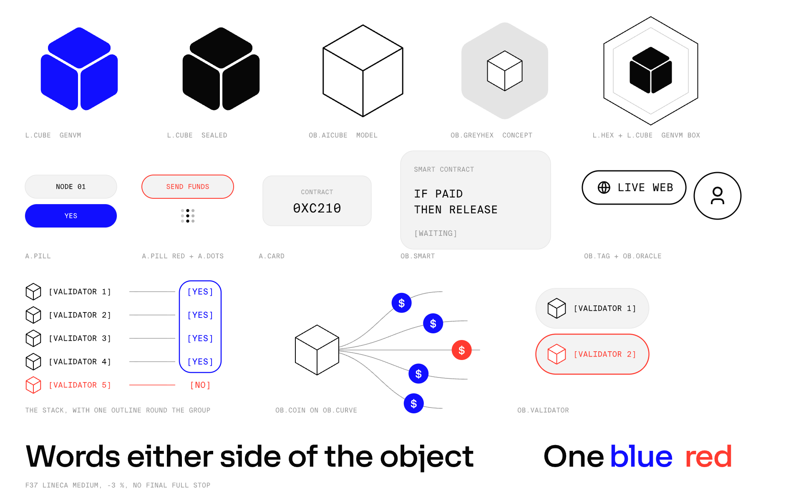

# Video & motion guidelines

How GenLayer makes videos and motion graphics. These rules apply to **video and motion
only** — interfaces follow [`DESIGN.md`](../../DESIGN.md). Where the two disagree (type,
black, red, gradients, entrances), video wins inside a video; see the table at the end of
[`video_illustration.md`](./video_illustration.md#what-differs-from-designmd).

## Pick the guide

| You're making | Read |
| --- | --- |
| Anything — what to draw, colour, type, composition, saying it correctly | [`video_illustration.md`](./video_illustration.md) — **always first** |
| A Fundamentals-style **explainer film** (voiceover, slow match cuts, SVG per frame) | [`video_explainer_films.md`](./video_explainer_films.md) |
| A **launch video** or fast motion graphic (hard cuts, expo curves, GSAP / HyperFrames / After Effects) | [`video_launch_motion.md`](./video_launch_motion.md) |
| Text that animates **letter by letter or word by word**, on a page or in a render | [`video_text_motion.md`](./video_text_motion.md) |

Explainers and launch videos have **different motion languages** — never mix them in one
piece. Explainers: `cubic-bezier(.45, 0, .15, 1)`, tiny match cuts, slow drift. Launch:
`expo.out` / `expo.in`, `D = 1.0 s`, hard cuts, push-in camera.

## Fonts

Video uses **F37 Lineca Medium** for words and **Suisse Intl Mono** for labels. GenLayer
holds licences for both; the files are **not** in this public repo — get them from the
team (see [`LICENSE-FONTS.md`](../../LICENSE-FONTS.md)). Third-party projects use Space
Grotesk and JetBrains Mono.

## Music

Generate music with an AI music model through an API. Don't synthesise it in code. If you
have a [fal.ai](https://fal.ai) key (`FAL_KEY`), it covers several models, such as
ElevenLabs Music, Lyria and MiniMax Music. Get approval before spending credits.

## With Claude Code

Install the `genlayer-video` skill (see the repo [README](../../README.md#option-a--install-the-claude-code-skills-recommended))
and just describe the piece — *"storyboard a 40-second explainer on appeals"*, *"make the
launch teaser for Testnet Bradbury"*, *"review this GSAP timeline against launch
motion"*. The skill routes to the right guide above.
