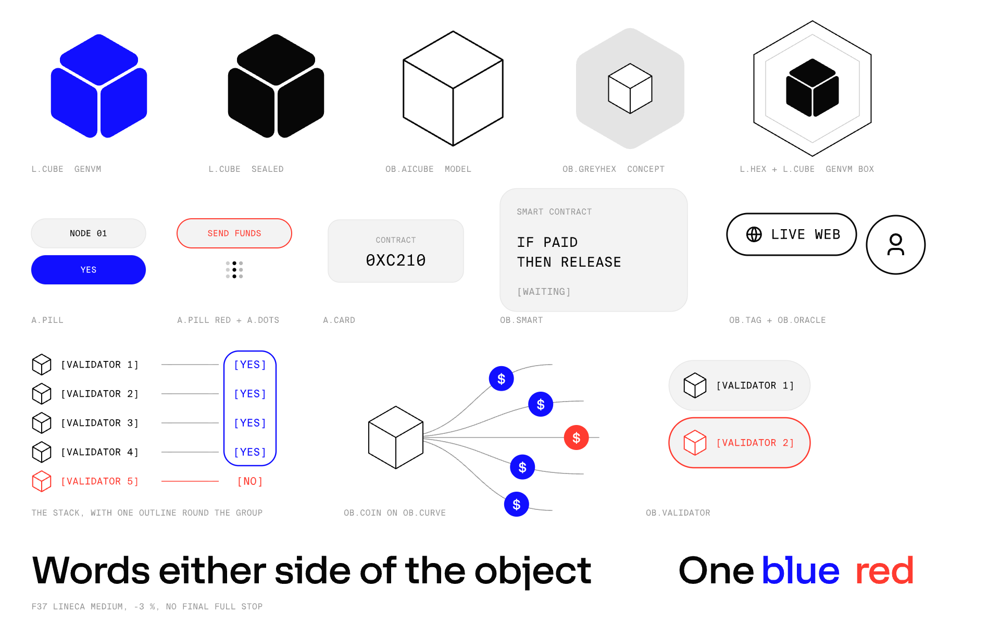

# Video: illustration

How GenLayer draws things in its explainer films and motion pieces. Plain, flat and literal: ink lines and grey fills on white, with one blue. Every object means one thing, and the same object means the same thing in every piece.

**Scope:** video and motion only. For interfaces, follow `DESIGN.md`. See [what differs from DESIGN.md](#what-differs-from-designmd).

## Vocabulary

| It means | Draw |
| --- | --- |
| GenVM, or a GenLayer block | The solid cube of three rounded faces. Blue once it can reach the world, black when it's sealed |
| An AI, model or validator's model | The sharp wireframe cube, white, with ink strokes as heavy as the line feeding it |
| A validator | That cube with the label `[VALIDATOR n]`. Always the same label, and never a copy of the film's hero object |
| A set of validators | A stacked column reached by L-shaped connectors, never radial, because that reads as a star |
| Agreement | One blue outline round the group |
| Failure, an attack, stolen money | Red: one red outline round the group, or red text |
| A result | Bracket text, not a pill: `[YES]`, `[NO]`, `[ACCEPTED]` |
| A smart contract | A grey card with one rigid rule |
| An Intelligent Contract | Its own look: white, blue stroke, holding code |
| Something outside the contract (web, model) | A white pill with an ink stroke, an icon and a mono label |
| A middleman or oracle | A circle with a person icon |
| Money moving | `$` coins on branching curves, blue, or red when stolen. Never a loader |
| Work in progress | A 3×3 dot loader |
| Greyboxing | A plain rounded grey hexagon |

## Colour

| Value | Use |
| --- | --- |
| `#FFFFFF` | Background |
| `#070707` | Lines and text |
| `#F3F3F3` | Cards and pills |
| `#E7E7E7`, `#CDCDCD` | Quiet strokes |
| `#999999` | Labels and connectors |
| `#110FFF` | The one accent: agreement, GenVM, the word that matters |
| `#FF3B30` | Failure |
| `#0A0A0A`, `#F7F8F8` | End card background and logo |

## Type

- **Words:** F37 Lineca Medium, -3 % tracking, with no final full stop or comma. Side words at 80 px on one line, on a 1920×1080 frame, so size the object to fit them.
- **Labels:** Suisse Intl Mono, always upper case, 0 tracking. The exceptions are on-screen code, which keeps its case, and the end-card tagline (32 px, 0.08 em tracking, 50 % opacity).
- **Moving text:** see `video_text_motion.md`.

## Composition

- The hero object sits dead centre, with the text optically centred on it and words either side.
- Keep about 90 % of text at vertical centre. Avoid text at the top or bottom of the frame.
- Outlines wrap the group, and single items get no coloured stroke. Never paint an agreeing set blue.
- Pills hug their content and share one width in a set.
- Drop words when the picture already says it. Labels that change meaning keep the same length.
- Side facts appear as notification pills around the centred object.

## A new concept

1. Find a real-world object for it. A metaphor beats a technical diagram: the Rosetta Stone for equivalence, telegraph tape for prompt injection, a keystone arch for consensus.
2. Let one hero object carry the whole piece, changing from shot to shot. A row of unrelated diagrams feels disconnected.
3. Give the concept its own shape, never another film's icon.
4. Show about three concepts as stills and get one picked before building.

## Don't

- Don't use real 3D or WebGL in explainers. Stay in plain 2D.
- No shadows, gradients, glass or glow.
- No inner line inside a blue shape.
- No ASCII or dollar-symbol effects.
- No fades in transitions.
- Don't render video to explore. Show a still, and compare options on one numbered board of stills.

## Say it correctly

These apply to any GenLayer piece:

- A majority **accepts** a result, but it isn't final. Never show unanimity as the requirement.
- No consensus means a **new leader retries**. That is not an appeal.
- An appeal is an **explicit challenge**, possible even on an accepted result, and brings more validators (2n + 1).
- A result is **final** only after the appeal window closes, and only then do funds move.

Have engineering check any on-screen code.

## What differs from DESIGN.md

| | `DESIGN.md` | Video |
| --- | --- | --- |
| Display type | Space Grotesk | F37 Lineca |
| Mono | JetBrains Mono, code only | Suisse Intl Mono, labels and code |
| Black | `#000000` | `#070707` |
| Red | `#E00000` | `#FF3B30` |
| Gradients | Brand gradient, flowing | None |
| Entrances | Fade + 10 px translate | No fade in transitions |

The blue is the same, `#110FFF`.

GenLayer holds licences for F37 Lineca, Suisse Intl and Suisse Intl Mono. The font files aren't in this public repo: get them from the team. Third-party projects use Space Grotesk and JetBrains Mono.
